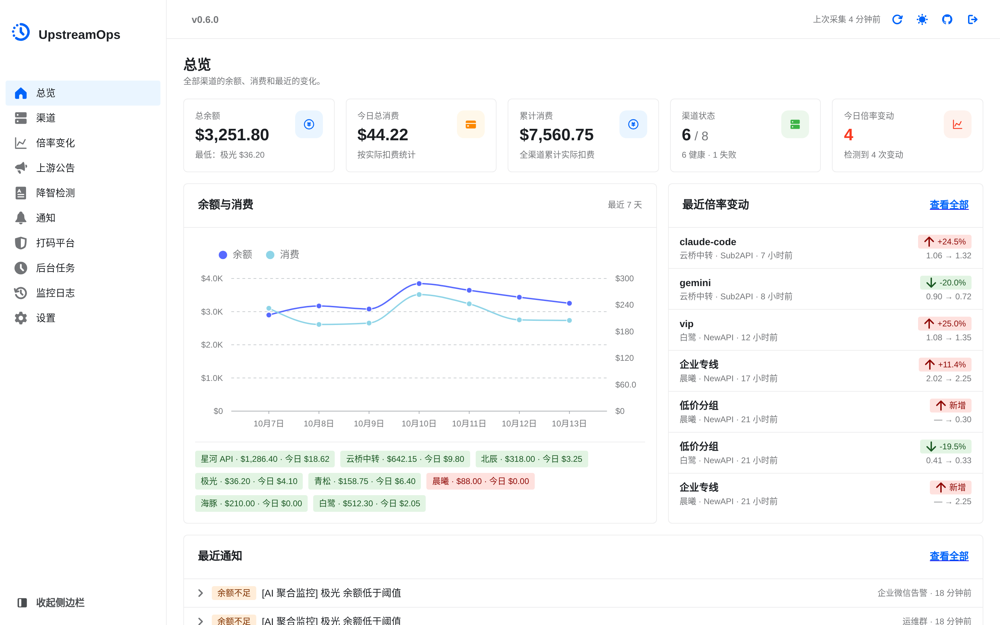
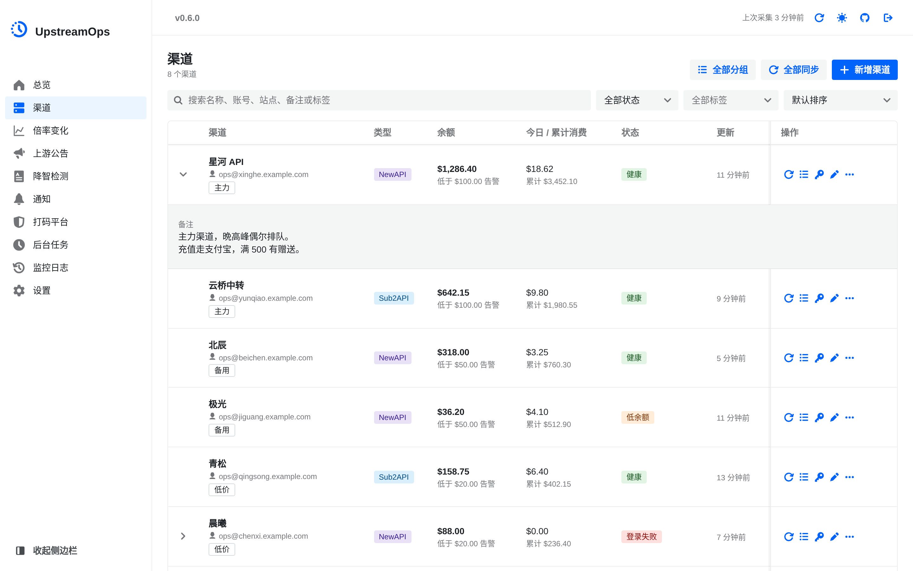
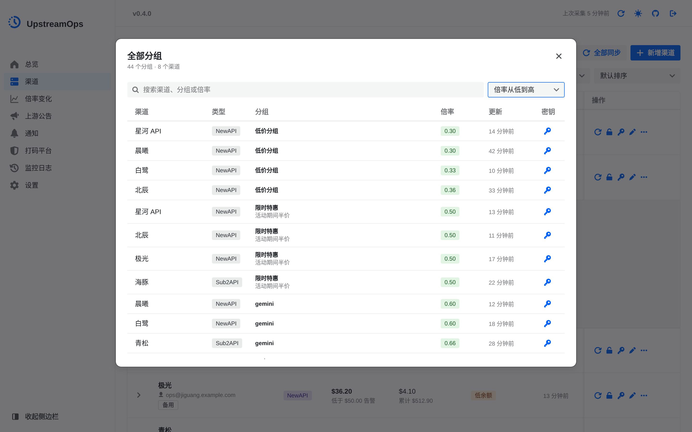
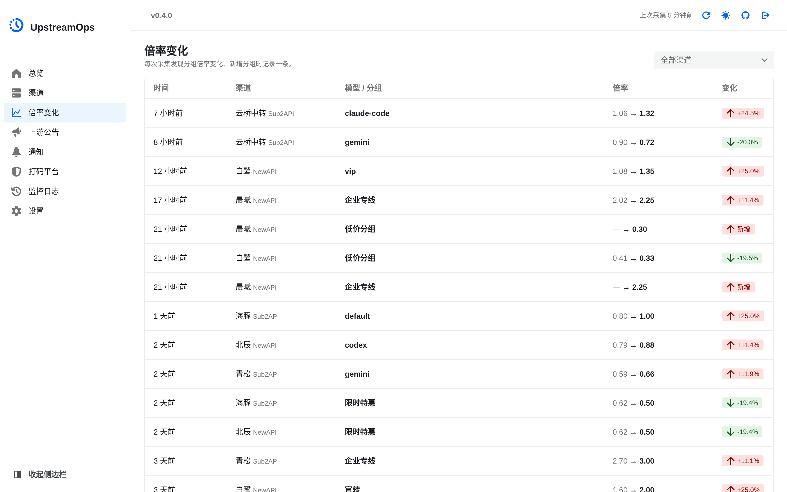
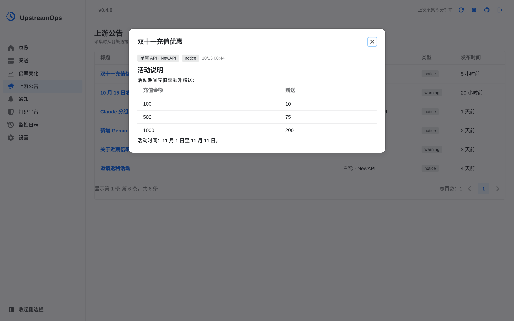
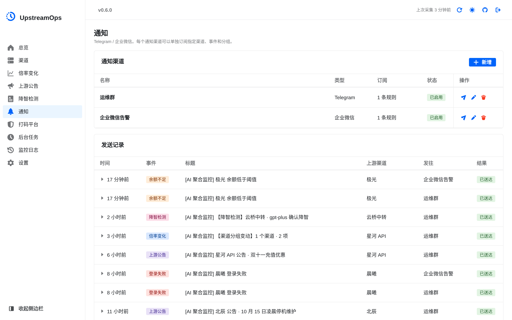
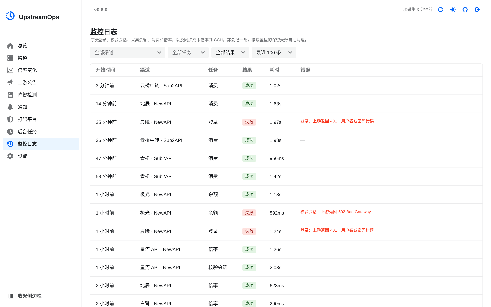
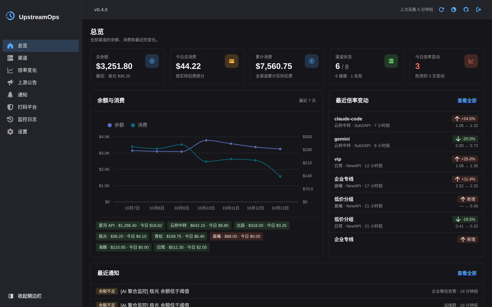
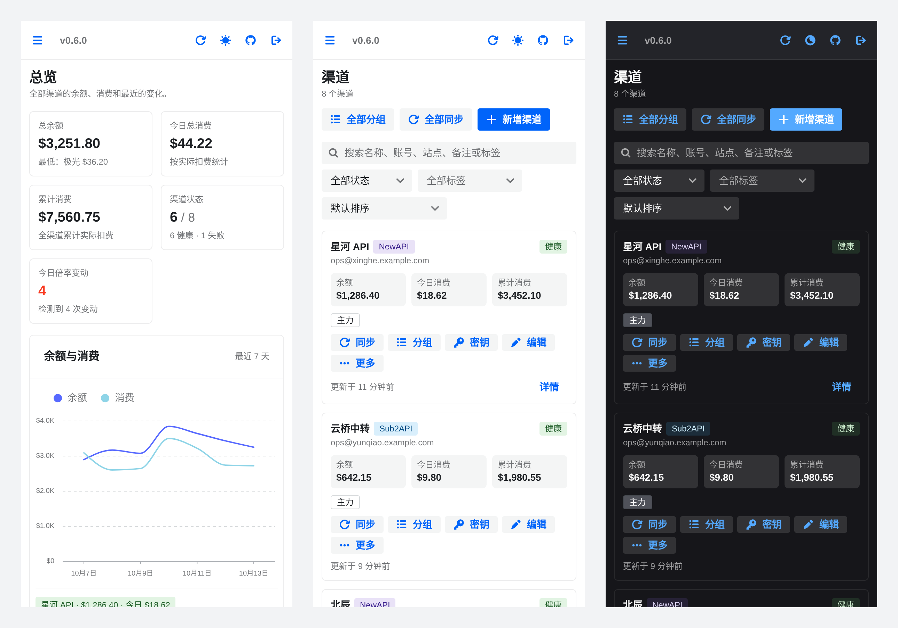

# UpstreamOps

> 本项目基于 [worryzyy/upstream-hub](https://github.com/worryzyy/upstream-hub) 二次开发，感谢原作者 [@worryzyy](https://github.com/worryzyy) 的开源工作。

> 本仓库 [yreidev/upstream-ops](https://github.com/yreidev/upstream-ops) 是 fork 自 [bejix/upstream-ops](https://github.com/bejix/upstream-ops) 的**自用精简版**，只保留我自己用得到的功能：去掉了请求转发网关、Sub2API 订阅管理、全局代理和 MySQL 支持，通知渠道只保留 Telegram 与企业微信，打码平台只保留 YesCaptcha。需要完整功能请使用上游仓库。

> UpstreamOps 是一个面向 NewAPI / Sub2API 上游站点的集中监控与运维面板，用来统一管理上游账号、查看余额与消费、同步模型倍率、追踪倍率变化、维护上游 API Key、发起充值/兑换，并通过 Telegram / 企业微信推送余额告警、倍率变更、登录异常、监控异常和上游公告。


## ❤️赞助商
<details open>
<summary>点击折叠</summary>

<table>
<tr>
<td width="180"><a href="https://cmzi.com/aff/CHTVTQWE"></a></td>
<td>感谢 触摸云 赞助了本项目！触摸云 是一家专注海外云计算服务的品牌，提供香港云服务器、美国高防云服务器、物理服务器、防御与加速 CDN、自研 CDN 系统等产品。触摸云为本软件用户提供了特别优惠，使用
<a href="https://cmzi.com/aff/CHTVTQWE">此链接</a></td>
</tr>


</table>

</details>

## 为什么使用？

当你同时维护多个 NewAPI / Sub2API 上游时，余额、消费、倍率、公告、API Key 和充值入口通常分散在不同后台。人工逐个登录检查不仅重复，而且很容易漏掉余额不足、倍率调整、登录失效或上游公告。

UpstreamOps 主要解决这些痛点：

- 集中看状态：把多个上游的余额、消费、倍率、公告和异常状态放到一个面板里。
- 减少人工巡检：定时同步余额、消费和倍率，不需要反复打开不同后台。
- 及时发现风险：余额低、倍率变化、登录失败和监控失败都可以推送通知。
- 保留变化记录：倍率变化、余额快照、通知日志和上游公告都会落库，方便回看问题发生时间。
- 简化日常运维：常用的 API Key 管理、充值和兑换可以在同一个入口处理。

它适合需要长期维护多个上游账号、关注余额和倍率变化、希望把上游运维从“人工看后台”变成“集中监控和主动告警”的场景。

## 预览

截图里的渠道、账号和金额都是虚构的演示数据。

总览：余额、消费、渠道状态，余额与消费走势，最近的倍率变动和通知。



渠道：桌面端是表格，点开一行看分组倍率、备注和报错；同步、测试登录、密钥、编辑等操作都在行尾。



全部分组：所有渠道的分组倍率放在一起，按倍率排序找最便宜的分组。



倍率变化：每次采集发现的倍率变化，可按渠道筛选。



上游公告：采集到的公告，详情按 Markdown 渲染。



通知：Telegram、企业微信通知渠道和发送记录。



监控日志：每次登录、校验会话、采集余额、消费和倍率的结果与耗时。



暗色主题：



手机上导航收进左上角的菜单，渠道列表改为卡片（右边是暗色）：



## 功能概览

### 上游渠道管理

- 支持 NewAPI / Sub2API 两类上游。
- 支持账号密码模式和 Token/Cookie 模式。
- 支持启用或关闭单个渠道监控。
- 支持自定义渠道排序，数值越大越靠前展示并优先参与监控。
- 支持配置余额告警阈值。
- 支持测试登录、手动同步余额、手动同步倍率。
- 支持账号密码模式配置附加登录表单参数，适配需要额外字段的 NewAPI / Sub2API 魔改版登录接口。
- 支持 Cloudflare Turnstile 打码配置，适用于开启 Turnstile 的上游登录场景。
- 支持在渠道的“更多”菜单中打开上游站点地址、暂停或恢复监控、清空已保存的登录信息。
- 支持按名称、账号、站点地址、备注或标签搜索渠道，按状态（健康 / 低余额 / 登录失败 / 尚未采集 / 已暂停）或标签筛选，并按名称、账号（中文按拼音）、健康状态或余额排序。
- 支持为渠道添加自定义标签和备注，标签可直接用于筛选。
- 渠道列表在桌面端是表格，点开一行查看分组倍率、备注和完整报错；窄屏改为卡片。列表显示登录账号；每页数量（10、20、50、100 或全部）会保存在浏览器中，刷新后保持不变。
- 支持「仅显示已创建密钥的分组」开关：开启后渠道列表里的分组倍率、“全部分组”和倍率变动通知只关注已创建密钥的分组；通知设置仍可看到全部分组，本地倍率快照也始终保留全量。
- 删除上游渠道时会自动清理相关快照、倍率、公告、通知冷却和通知日志。

### 余额与消费监控

- 总览页展示总余额、今日消费、累计消费、最低余额渠道、异常渠道数量、今日倍率变动，以及余额与消费走势、最近倍率变动和最近通知。
- 今日消费按北京时间跨天：渠道当天还没有采集到消费（例如已暂停监控）时，今日消费显示为 0。
- 支持周期性采集余额和消费。
- 支持余额历史趋势图。
- 支持余额低于阈值时通知推送；消费采集失败不影响低余额提醒。
- 支持余额告警冷却，避免同一渠道持续低余额时刷屏。
- Sub2API 站点屏蔽了仪表盘接口（`/api/v1/usage/dashboard/*` 返回 404）时，消费改从使用记录统计接口 `/api/v1/usage/stats` 采集。
- 支持按充值倍率换算余额、消费和兑换结果，可跟随上游倍率，也可手动选择除以或乘以倍率。

### 倍率监控

- 支持同步上游分组/模型倍率。
- 支持记录倍率变化历史。
- 支持倍率变化历史分页查询和按渠道过滤。
- 支持倍率变化通知。
- 支持同一次扫描内多条倍率变化合并推送。
- 支持同一次扫描内新增分组和删除分组合并为一条“分组变动通知”，通知标题格式为 `[分组变动通知] 渠道名 · 新增 X / 删除 Y`，正文会分别列出新增分组的倍率和删除分组的原倍率，避免新增、删除分开推送导致同一轮扫描刷屏。
- 支持按变化百分比过滤小幅变动。
- 通知订阅可按上游渠道和倍率分组过滤。
- 支持在渠道页的“全部分组”里查看全部渠道的分组，并按渠道或倍率搜索排序。

### CCH 成本倍率同步

- 每轮倍率采集后，把上游分组倍率同步成 [Claude Code Hub](https://github.com/ding113/claude-code-hub)（CCH）供应商的成本倍率。
- 按“站点地址相同、密钥尾号相同”自动配对 CCH 供应商和上游密钥，密钥换了分组也会跟上。
- 改了哪些供应商、从多少改到多少会发通知；同步失败写监控日志，并按连续失败去重通知。
- 设置页填写 CCH 地址和管理令牌，可以先检查配对再手动同步。详见 [CCH 成本倍率同步说明](#cch-成本倍率同步说明)。

### 验证码余额管理

- 支持查询打码平台（YesCaptcha）的账户余额。
- 支持手动刷新单个打码平台的余额。
- 支持批量刷新全部打码平台的余额。
- 余额信息包括余额数值、余额单位和最后刷新时间，异常时会显示错误信息。
- 验证码配置列表展示各平台余额状态，方便运维人员及时充值。

### 上游 HTTP 配置

- 支持配置上游请求超时时间和 `User-Agent`。

### 上游公告同步

- 支持从 NewAPI 同步公告：
  - `/api/status` 中的 `announcements`。
  - `/api/notice` 文本公告。
- 支持从 Sub2API 同步用户可见公告：
  - `/api/v1/announcements`。
- 公告同步跟随倍率同步执行，不额外增加独立定时任务。
- 首次采集只建立公告基线，不推送历史公告。
- 后续发现新增公告会写入本地公告表，并通过现有通知渠道推送。
- “上游公告”页分页列出公告，点开查看详情。
- 公告详情按 Markdown 渲染，夹带的 HTML 按白名单过滤。
- 删除上游渠道时会自动清理该渠道关联公告。
- 支持按保留天数自动清理过期公告。
- 公告推送结果会出现在“通知”页的发送记录中。
- 支持渠道级公告忽略开关 `ignore_announcements`，开启后不再拉取该渠道的公告，也就不会推送，适用于需要静默特定渠道公告的场景。

### 通知渠道

支持以下通知渠道：

- Telegram
- 企业微信

通知渠道支持订阅过滤：

- 留空或 `[]`：接收全部事件。
- 选择上游时可选“全部渠道”，以后新增的上游也会自动包含。
- `mode=all`：接收指定上游的全部事件。
- `mode=groups`：倍率变化只接收指定分组；公告、余额、登录失败、监控失败等事件仍按上游渠道过滤，不受分组过滤影响。

### 上游 API Key 管理

点渠道的“密钥”按钮，在右侧抽屉里管理上游 API Key：

- 查看上游 API Key 列表。
- 按名称或 Key 搜索。
- 按状态筛选。
- 新建 API Key。
- 编辑名称、分组、状态、额度、过期时间、IP 白名单/黑名单、模型限制等字段。
- 删除 API Key。
- 获取并复制完整 Key。
- 在分组倍率表（渠道展开行、卡片的“分组与详情”、“全部分组”）中可直接为指定分组新建 API Key，或从当前渠道选择一个现有 API Key 迁移到该分组。
- 迁移前会重新校验目标分组并显示原分组到目标分组的二次确认；已在目标分组的 Key 仅展示、不可重复选择。
- “名称改为分组名”一键把当前渠道全部 Key 的名称改成各自所属的分组名；已经同名、未分组、分组不在上游现有分组里的跳过，NewAPI 名称超过 50 字节的也跳过，完成后列出跳过和失败的 Key。
- 分组名旁边有复制按钮，“打开站点密钥页”在新标签页打开上游站点的密钥管理页（`/keys`）。有的站点只允许在它自己的网页上改密钥，一键改名会被拒绝，可以复制分组名过去手动改。

不同上游支持的字段存在差异，前端会按 NewAPI / Sub2API 的接口能力展示对应表单。

### 充值与兑换

在渠道的“更多”菜单中可以直接处理上游充值和兑换：

- 支持查询上游充值配置。
- 支持支付宝 / 微信支付等上游返回的支付方式。
- 支持二维码、跳转链接、表单提交等支付发起方式。
- 支持桌面端优先二维码，移动端优先跳转。
- 支持兑换码在线兑换。
- 兑换成功后会根据返回内容展示余额、并发、分组订阅等结果。
- 兑换对话框支持输入兑换码后即时兑换，结果展示兑换类型、价值、新余额、新并发、分组名称和有效期等信息。

### 系统设置

系统设置页集中管理：

- 后台登录鉴权。
- 管理员账号密码。
- Token 签名密钥。
- 余额同步 cron。
- 倍率同步 cron。
- 并发数量。
- 监控日志、余额快照、通知日志保留天数。
- 上游公告保留天数。
- 倍率变化通知合并策略。
- 倍率变化最小推送百分比。
- 余额低告警冷却时间。
- 通知最大重试次数。
- 检测更新：发现新版本时弹窗显示当前版本之后各版本的更新日志（取自 GitHub Releases）。
- 上游请求超时时间和 `User-Agent`。

保存配置会写入配置文件；点“应用”后，鉴权、调度、通知策略与上游 HTTP 配置会立即生效。设置了对应环境变量的项以环境变量为准，在设置页上置灰并注明变量名，要改得改环境变量后重启。CCH 成本倍率同步在设置页下方单独保存，写入数据库后立即生效。通知渠道和打码平台在各自页面管理，改动实时写库生效。

## 快速启动

### Docker Compose

使用 SQLite 单文件数据库，推荐直接用 Docker Compose：

```bash
cp .env.example .env
```

编辑 `.env`，至少设置：

```env
APP_SECRET=请替换为 32 字节以上随机字符串
```

`APP_SECRET` 用于 AES-GCM 加密敏感字段，包括上游密码、Token、Cookie、通知渠道密钥、验证码平台 API Key 等。修改后既有加密数据将无法解密，请务必妥善保存。

公网访问建议开启后台登录：

```env
AUTH_ENABLED=true
ADMIN_USERNAME=admin
ADMIN_PASSWORD=请替换为强密码
```

Docker 默认拉取本仓库发布的 `ghcr.io/yreidev/upstream-ops:${IMAGE_TAG:-latest}`（版本见 [Releases](https://github.com/yreidev/upstream-ops/releases)），不会在本机编译镜像。配置和数据都会写入宿主机项目目录下的 `data/`。

启动：

```bash
docker compose up -d
```

默认访问地址：

```text
http://localhost:8080
```

默认数据文件在容器内：

```text
/app/data/upstream-ops.db
```

宿主机对应文件是项目根目录下的 `data/upstream-ops.db`。系统设置配置文件会持久化到 `data/config.yaml`。

### 固定镜像版本

默认镜像 Tag 来自 `.env`：

```env
IMAGE_TAG=latest
```

生产环境建议锁定具体版本，例如：

```env
IMAGE_TAG=v0.5.0
```

## 环境变量

### 基础配置

```env
HTTP_PORT=8080
IMAGE_TAG=latest
SERVER_MODE=release
LOG_LEVEL=info
```

- `HTTP_PORT`：宿主机暴露端口。
- `IMAGE_TAG`：镜像版本。
- `SERVER_MODE`：Gin 运行模式，通常为 `release`。
- `LOG_LEVEL`：日志等级。

### 数据库配置

只支持 SQLite：

```env
DATABASE_PATH=/app/data/upstream-ops.db
```

### 安全与登录

```env
APP_SECRET=please-change-me-to-a-long-random-secret-32bytes-min
AUTH_ENABLED=false
ADMIN_USERNAME=admin
ADMIN_PASSWORD=
AUTH_TOKEN_SECRET=
```

- `APP_SECRET`：主密钥，必填。
- `AUTH_ENABLED`：是否启用后台登录。
- `ADMIN_USERNAME`：后台管理员账号。
- `ADMIN_PASSWORD`：后台管理员密码。
- `AUTH_TOKEN_SECRET`：登录 Token 签名密钥；留空时使用 `APP_SECRET`。

## 本地开发

### 后端

```bash
go run ./cmd/server
```

默认后端端口：

```text
8418
```

### 前端

```bash
cd frontend
pnpm install
pnpm dev
```

默认前端开发地址：

```text
http://127.0.0.1:3010
```

### 验证命令

```bash
go test ./...
```

```bash
cd frontend
pnpm lint
pnpm exec tsc --noEmit --incremental false
pnpm build
```

### 发版

1. 在 [docs/CHANGELOG.md](docs/CHANGELOG.md) 把“未发布”标题改成 `## vX.Y.Z（YYYY-MM-DD）`，同时修改 `backend/global/version.go` 的版本号和上文 `IMAGE_TAG` 示例。
2. 提交后打 tag 并推送：`git tag vX.Y.Z && git push origin main vX.Y.Z`。
3. 发布工作流先跑测试并确认更新日志里有这个版本，再构建、推送镜像，最后用这段更新日志创建 GitHub Release，末尾附镜像地址和 digest。

推送 main 只跑测试，不构建镜像。

## 上游 HTTP 配置

系统设置页可以配置上游请求参数。上游请求超时默认 `30` 秒，`User-Agent` 默认 `upstream-ops/0.1`。

配置文件字段：

```yaml
upstream:
  timeoutSeconds: 30
  userAgent: upstream-ops/0.1
```

- `upstream.timeoutSeconds`：访问上游站点的请求超时时间。
- `upstream.userAgent`：访问上游站点时使用的 `User-Agent`。

## 上游渠道配置

### NewAPI

支持两种凭据方式：

#### 账号密码模式

填写上游站点地址、用户名、密码。若上游登录接口需要额外字段，可以在“附加表单参数”中填写 JSON 对象；若上游开启 Turnstile，需要先在“验证码服务”中配置打码平台，然后在渠道中启用 Turnstile。

新版 NewAPI（QuantumNous/new-api 及其分叉）登录后改用短期 `access_token`（Bearer JWT，默认 15 分钟）鉴权，并随响应下发 `new_api_refresh` 刷新令牌。UpstreamOps 会在令牌临近过期时自动调用 `/api/user/auth/refresh` 续期并轮换刷新令牌，无需频繁重新登录；老版本 NewAPI 仍走 `Set-Cookie: session=...` + `New-Api-User` 头鉴权，由程序自动识别兼容。

登录与续期请求会携带由站点地址推导的 `Origin` / `Referer`。只有上游明确返回 401（刷新令牌失效）时才回退到账号密码重新登录；403、409、429、5xx、网络错误等其它失败会保留现有会话并记录错误，避免反复登录占满上游的会话数上限。同一渠道的会话刷新与登录会串行执行。

校验已有会话或 token 时，如果只是上游暂时不可用（超时、网络错误、408、429、5xx），会保留会话、这一轮直接记为失败，不会去刷新或重新登录，也不会提示“token 已失效”。

定时任务的自动登录带退避：登录失败后，下次自动登录分别等 15 分钟、30 分钟、1 小时，之后每 2 小时一次。账号密码错误、账号被封禁或停用、打码平台余额不足这类不处理就不会好的错误，会暂停自动登录，渠道的错误信息末尾会注明“已暂停自动登录”；修改渠道配置、清空登录信息、修改对应的打码配置、打码余额充值后被查到，或手动刷新 / 测试登录成功后恢复。手动刷新和测试登录不受退避限制。退避和暂停状态写入数据库，重启后仍然生效。

#### Token/Cookie 模式

适合不希望程序自动登录，或上游登录存在额外验证的场景。需要提供：

```json
{
	"cookie": "session=xxx; other=yyy",
	"user_id": "123"
}
```

- `cookie`：浏览器开发者工具中复制的 Cookie。
- `user_id`：NewAPI 个人设置页中的用户 ID。

NewAPI token 模式同样支持使用系统访问令牌（`user.access_token`，即 NewAPI 个人设置页生成的「系统访问令牌」，32 位字符串）鉴权。改用 `access_token` 字段代替 `cookie`，二者互斥；`user_id` 仍必填：

```json
{
	"access_token": "your-system-access-token",
	"user_id": "123"
}
```

编辑 NewAPI Token/Cookie 渠道时，表单会回显已保存的 `user_id` 便于复用，但不会回显已保存的 Cookie 或访问令牌。

### Sub2API

支持账号密码模式和 Token 模式。

Token 模式凭据：

```json
{
	"access_token": "your-access-token",
	"refresh_token": "your-refresh-token"
}
```

`refresh_token` 可选但建议填写。填写后，Sub2API 会话和 Token 模式凭据可在 access token 失效后自动刷新；不填写时，Token 失效后需要重新粘贴凭据。

### 清空登录信息

渠道的“更多”菜单支持清空登录信息：

- 账号密码模式：只清空缓存会话。
- Token 模式：清空缓存会话，并清空已保存的 token/cookie 凭据 JSON。

## 通知渠道配置

通知渠道的 Bot Token、Webhook 地址等敏感配置会加密保存。新增或编辑通知渠道时，按渠道类型填写对应 JSON。

### Telegram

```json
{
	"bot_token": "1234567890:AAEh...",
	"chat_id": "-1001234567890"
}
```

- `bot_token`：从 Telegram 的 `@BotFather` 创建机器人后获取。
- `chat_id`：接收消息的私聊、群组或频道 ID。

消息用 HTML 格式发送，分组名里的 `_`、`*` 等字符不会导致解析失败；正文超长会截断。Telegram 返回 429 时按它给的 `retry_after` 等待后重试，返回 400、401、403、404 不再重试。发送失败的错误信息不含 Bot Token。

### 企业微信

```json
{
	"webhook_url": "https://qyapi.weixin.qq.com/cgi-bin/webhook/send?key=xxxx"
}
```

填写群机器人的完整 Webhook URL。

发送结果以接口返回的 `errcode` 为准（HTTP 状态总是 200）：限频（45009）等一分钟后重试，Webhook 无效（93000）、参数错误（40058）不再重试。markdown 内容超过 4096 字节会截断。发送失败的错误信息不含 Webhook key。

## 订阅规则

通知渠道可以限制只接收指定上游、指定事件或指定倍率分组的事件。留空、空字符串、`null` 或 `[]` 表示接收全部上游的全部事件。

```json
[
	{ "channel_ids": [1, 2], "mode": "all" },
	{ "channel_ids": [3], "mode": "groups", "groups": ["default", "pro"], "events": ["rate_changed"] },
	{ "channel_ids": [4], "mode": "all", "events": ["announcement", "monitor_failed"] },
	{ "channel_ids": [1, 2, 3, 4], "all_channels": true, "mode": "all", "events": ["login_failed", "recovered"] }
]
```

- `channel_ids`：上游渠道 ID 列表。历史 `channel_id` 单值规则仍兼容。
- `all_channels`：为 `true` 时匹配全部上游（含以后新增的），忽略 `channel_ids`；`channel_ids` 仍保存保存时的全选结果，方便回滚到旧版本。
- `events`：事件类型列表。缺省、`null` 或 `[]` 表示接收该上游全部事件；非空时只接收指定事件。
- `mode=all`：倍率类事件接收该上游所有分组。
- `mode=groups`：倍率类事件只接收 `groups` 中指定的模型或分组。
- 前端事件选择会把 `rate_structure_changed` / `rate_added` / `rate_removed` 合并显示为“分组变动”；保存时仍写入具体事件值。

倍率相关事件的过滤规则：

- 订阅规则会先按 `channel_id` 匹配上游，再按 `events` 匹配事件类型。
- `rate_changed` 会按当前倍率变化的分组名匹配 `groups`。
- `rate_structure_changed` 是同一次扫描内新增分组和删除分组合并后的结构变动通知，也会按分组名匹配 `groups`。
- 对于 `rate_structure_changed`，每个通知渠道会先按自己的订阅规则裁剪新增/删除分组列表，再生成该通知渠道看到的合并通知；因此订阅了不同分组的通知渠道不会看到自己未订阅的分组。
- 如果某个通知渠道在本轮新增/删除分组中没有任何订阅命中的分组，则不会收到这条 `rate_structure_changed` 通知。

公告事件的过滤规则：

- 公告按 `channel_id` 匹配上游渠道。
- 分组过滤不影响公告事件。
- 只要订阅命中该上游且 `events` 为空或包含 `announcement`，公告就会推送。

通知发送记录在“通知”页分页查看，总览页展示最近几条，点一行可以展开正文和失败原因。所有通知标题统一使用 `[AI 聚合监控]` 前缀，方便在 Telegram、企业微信中做过滤和归档。

## 通知事件类型

当前事件类型包括：

- `balance_low`：余额低于阈值。
- `rate_changed`：倍率变化。
- `rate_structure_changed`：分组结构变动。用于同一次扫描内发现新增分组或删除分组时的合并通知，标题使用 `[分组变动通知] 渠道名 · 新增 X / 删除 Y`，正文分别列出新增分组和删除分组。
- `rate_added`：分组新增。该事件类型仍保留在系统事件枚举中，用于兼容历史通知日志或旧版本数据；当前新增分组推送会优先合并进 `rate_structure_changed`。
- `rate_removed`：分组删除。该事件类型仍保留在系统事件枚举中，用于兼容历史通知日志或旧版本数据；当前删除分组推送会优先合并进 `rate_structure_changed`。
- `announcement`：上游公告新增。
- `login_failed`：登录失败（含 Token 模式下 token 已失效）。
- `captcha_failed`：验证码求解失败。
- `monitor_failed`：会话校验、余额、消费或倍率采集失败。
- `recovered`：之前发过失败通知的登录、打码、采集或 CCH 同步恢复正常。
- `cch_sync`：CCH 成本倍率同步改了供应商，或同步失败。它不属于某个上游，订阅规则只按事件匹配，选了哪些上游不影响。

失败通知按“上游 + 失败类别（登录、打码、会话校验、余额、消费、倍率）”去重，CCH 同步失败单独算一类：

- 同类连续失败至少 2 次、且距第一次失败已超过 10 分钟才通知，偶发的一次超时不会推送。
- 账号密码错误、账号被停用、打码余额不足、CCH 令牌无效等不处理就不会好的错误立即通知。
- 通知后仍未恢复，每 6 小时提醒一次。
- 恢复后发送一条 `recovered` 通知，注明连续失败次数和持续时间；没有发过失败通知的不发恢复通知。
- 连续失败计数保存在数据库表 `notification_failure_states`，重启不丢。

从旧版本升级时会做一次性迁移：选中了当时全部上游的订阅规则改为“全部渠道”；事件列表非空的规则补上 `login_failed`、`monitor_failed`、`recovered`、`cch_sync`，并去掉已移除功能的 `subscription_*` 事件；旧通知日志错误信息里的 Telegram Bot Token、企业微信 Webhook key 会被替换成 `***`。

## 上游公告同步说明

公告同步跟随倍率同步执行：

- 定时倍率同步会同步公告。
- 手动同步倍率也会同步公告。
- 不新增独立公告 cron。

首次同步逻辑：

- 如果某个上游渠道本地还没有公告记录，第一次拉到的公告只入库。
- 首次入库不发送通知，避免历史公告刷屏。

后续同步逻辑：

- 根据 `channel_id + source_key` 去重。
- NewAPI 优先使用公告 `id`。
- NewAPI 没有 `id` 时使用内容、发布时间、类型等字段生成哈希。
- NewAPI `/api/notice` 文本公告按文本内容生成哈希；文本变化会被视为新公告。
- Sub2API 使用公告 `id`。
- 新公告入库后触发 `announcement` 通知。

前端展示：

- “上游公告”页按页列出公告，点击公告打开详情弹窗。
- 公告正文按 Markdown 渲染，夹带的 HTML 按 GitHub 同款白名单过滤。
- “通知”页的发送记录里会显示公告通知发送成功或失败。

公告列表接口：

```text
GET /api/announcements?page=1&page_size=20
```

返回分页结构：

```json
{
	"items": [],
	"total": 0,
	"page": 1,
	"page_size": 20,
	"pages": 1
}
```

渠道删除逻辑：

- 删除上游渠道时，会自动删除该渠道关联的公告记录。
- 公告也可以通过保留策略按 `first_seen_at` 定期清理。

## 日志与分页接口

通知日志、倍率变化日志、公告列表都使用分页接口，避免页面一次性拉取大量历史数据。

通知日志：

```text
GET /api/notifications/logs?page=1&page_size=20
```

返回内容会附带通知渠道名称、通知渠道类型，以及关联事件对应的上游渠道 ID，便于前端展示。

倍率变化日志：

```text
GET /api/rate-changes?page=1&page_size=20
GET /api/rate-changes?channel_id=1&page=1&page_size=20
```

公告列表：

```text
GET /api/announcements?page=1&page_size=20
```

渠道列表分页：

```text
GET /api/channels?page=1&page_size=20
GET /api/channels?page=1&page_size=-1  (返回全部)
GET /api/channels?page=1&page_size=20&q=vip&status=healthy&tag=备用&sort=balance&order=desc
POST /api/channels/:id/clear-login-info
```

分页模式（带 `page` / `page_size`）支持以下可选参数，不带分页参数的全量列表会忽略它们：

- `q`：按名称、账号、站点地址、备注、标签做子串搜索（忽略英文大小写），最多 200 个字符。
- `status`：`healthy`（健康）、`low`（低余额）、`failed`（登录失败）、`idle`（尚未采集）、`paused`（已暂停）。
- `tag`：单个标签精确匹配（忽略英文大小写），不能含逗号，最多 32 个字符。
- `sort`：`default`（默认，按渠道排序值）、`name`、`username`、`health`、`balance`；名称和账号依次按数字符号、中文（按拼音）、英文字母（忽略大小写）排序，与浏览器 `zh-CN` 的排序一致（个别多音字可能不同）；空账号和未采集余额的渠道总是排在最后。
- `order`：`asc`（默认）或 `desc`，`sort=default` 时忽略。

取值不合法或超长时返回 400；`total` / `pages` 为筛选后的数量。

返回统一分页结构：

```json
{
  "items": [],
  "total": 0,
  "page": 1,
  "page_size": 20,
  "pages": 1
}
```

## API Key 管理说明

API Key 管理依赖上游自身接口，不同上游字段存在差异。

常见操作：

- 列表分页。
- 搜索名称或 Key。
- 状态筛选。
- 新建 Key。
- 编辑 Key。
- 删除 Key。
- Reveal 完整 Key 并复制。

NewAPI 场景下会适配 NewAPI 的 token 接口。Sub2API 场景下会适配 Sub2API 的 keys 接口与 group 接口。

NewAPI 的修改接口会把请求里没带的字段清零，所以修改 Key（包括迁移分组、一键改名）时会先读出这个 Key 的全部字段，改动后整条写回；启用、停用状态另发一次只改状态的请求。

## CCH 成本倍率同步说明

把上游分组倍率写进 Claude Code Hub（CCH）供应商的成本倍率（`cost_multiplier`），让 CCH 里按成本算的毛利跟上上游调价。

配置在设置页的“CCH 成本倍率同步”：

- CCH 地址：CCH 管理后台的地址，如 `https://cch.example.com`，末尾多填的 `/api/v1` 会自动去掉。和 upstream-ops 部署在同一集群时也可以填内网服务地址。
- 管理令牌：CCH 的 `ADMIN_TOKEN`，AES-GCM 加密存在数据库里，接口和页面都不回显，留空保存表示不改。
- 自动同步：开启后每轮定时倍率采集结束都同步一次；关着也能手动同步。

配对与同步规则：

- 用 CCH 管理接口 `GET /api/v1/providers` 列出全部供应商（含已停用的），`PATCH /api/v1/providers/{id}` 只改 `cost_multiplier`。
- 供应商地址的主机名（忽略大小写、端口和开头的 `www.`）和渠道站点地址相同，且密钥末 4 位相同，就算对上。同一站点找到多把尾号相同的密钥时不同步，在配对结果里列出来。
- 目标成本倍率等于这把密钥当前所在分组的倍率，不做换算，按 CCH 的精度保留 4 位小数后比较，相同就不改。
- 只读开着监控的渠道的密钥；渠道暂停监控、密钥没有分组或分组已不在上游可用分组里、分组倍率为 0、CCH 没露出密钥尾号的供应商都不同步，配对结果里写明原因。
- 每轮同步写一条监控日志（任务“CCH 同步”，渠道显示为 CCH）。有修改时发一条 `cch_sync` 通知，列出供应商从多少改到多少；整轮失败或有供应商改失败时按上面的失败去重规则通知。

接口：

```text
GET  /api/cch-sync           读取配置和上次同步结果（令牌只返回是否已填）
PUT  /api/cch-sync           保存配置：{"enabled": true, "base_url": "...", "token": "留空不改"}
POST /api/cch-sync/preview   只配对、算出要改成多少，不改 CCH
POST /api/cch-sync/run       立即同步一轮
```

## 充值与兑换说明

充值能力取决于上游是否暴露对应接口和支付配置。

支持能力：

- 查询充值金额范围、预设金额、可用支付方式。
- 发起支付宝或微信支付。
- 处理二维码支付、跳转支付和表单提交。
- 展示上游返回的帮助文字和帮助图片。

充值接口：

```text
GET  /api/channels/:id/recharge-info         查询充值信息
POST /api/channels/:id/recharge              发起充值
```

兑换能力：

- 输入兑换码后直接调用上游兑换接口。
- 成功后展示上游返回的结果。
- 常见结果包括余额增加、并发增加、分组订阅、有效期等。

兑换接口：

```text
POST /api/channels/:id/redeem               兑换码兑换
```

请求体：

```json
{"code": "your-redeem-code"}
```

返回示例：

```json
{
  "message": "兑换成功",
  "type": "recharge",
  "value": 10.00,
  "new_balance": 50.00,
  "new_concurrency": 5,
  "group_name": "default",
  "validity_days": 30
}
```

## 验证码服务

验证码服务用于上游登录时自动求解 Cloudflare Turnstile。

只支持 YesCaptcha。

配置步骤：

1. 在”系统设置 -> 验证码服务”新增 YesCaptcha 配置。
2. 填写 API Key 和可选 endpoint。
3. 在渠道配置中启用 Turnstile，并选择对应验证码服务。
4. 后续登录上游时会自动拉取 site key 并调用 YesCaptcha 求解。

Token/Cookie 模式不需要验证码服务。

验证码余额管理接口：

```text
GET    /api/captcha-configs                    列出全部验证码配置（含余额信息）
POST   /api/captcha-configs                    新增验证码配置
PUT    /api/captcha-configs/:id                更新验证码配置
POST   /api/captcha-configs/:id/refresh-balance 手动刷新余额
DELETE /api/captcha-configs/:id                删除验证码配置
```

余额刷新会向对应打码平台查询账户余额，更新 `last_balance`（余额数值）、`balance_unit`（YesCaptcha 为 points）、`balance_at`（刷新时间）字段。查询失败时 `balance_error` 字段会记录错误信息。

## SSE 实时进度推送

部分操作耗时较长（如测试登录、批量同步余额和倍率），后端通过 Server-Sent Events（SSE）向前端推送实时进度：

- 测试登录时会推送登录进度、Turnstile 求解状态和最终结果。
- 单渠道同步会串行推送余额同步和倍率同步的进度。
- 全量同步会推送每个渠道的同步进度，附带渠道索引（当前数/总数）。
- 前端通过 `ReadableStream` 消费 SSE 事件流，在 UI 中实时展示进度状态和结果摘要。

SSE 接口：

```text
POST /api/channels/:id/test-login              测试登录（SSE）
POST /api/channels/:id/sync                    单渠道同步（SSE）
POST /api/channels/sync-all                    全量同步（SSE）
```

响应格式为 `text/event-stream`，每行格式：

```text
data: {“event”:”progress”,”message”:”...”,”step”:1,”total”:3,”ok”:true}
```

## 运行时配置热重载

系统设置页支持运行时热重载，无需重启服务即可使配置生效：

- 可热重载的配置模块：`app`（应用设置）、`auth`（登录鉴权）、`scheduler`（调度器）、`notifications`（通知策略）、`retention`（数据保留）、`upstream`（上游 HTTP 配置）。
- 点击“应用”后，调度器会按新的 cron 间隔重启，通知策略（合并策略、最小变化百分比、冷却时间等）会即时更新。
- 验证码服务和通知渠道的增删改本身即写库实时生效，无需额外应用。
- 其他配置（如数据库路径、HTTP 端口、日志等级）需要重启服务。

## 调度与保留策略

默认调度：

- 余额同步：每 15 分钟。
- 倍率同步：每 30 分钟。
- 验证码余额刷新：随调度自动刷新，也可手动刷新。
- 历史清理：每天凌晨执行。

默认保留策略：

- 监控日志保留 30 天。
- 余额快照保留 90 天。
- 通知日志保留 90 天。
- 上游公告按”公告保留天数”清理，0 表示不清理。
- 倍率变化日志默认不清理。

这些配置可以在系统设置页调整，也可以通过配置文件和环境变量管理。点击“应用”后，`app`、`auth`、`scheduler`、`notifications`、`retention`、`upstream` 会立即生效，调度器会按新配置重启。环境变量优先于配置文件：除了 `APP_SECRET`、`ADMIN_USERNAME`、`ADMIN_PASSWORD`、`AUTH_ENABLED`、`AUTH_TOKEN_SECRET` 这几个专门的名字，其它配置项的环境变量名是路径转大写、点换下划线，比如 `SCHEDULER_RATECRON`、`SCHEDULER_RETENTION_MONITORLOGSDAYS`。启动和点“应用”都按这个规则读，设置页保存时不会把环境变量的值写进配置文件。

## 数据安全说明

以下敏感字段会使用 `APP_SECRET` 加密保存：

- 上游账号密码。
- NewAPI Cookie。
- Sub2API Access Token。
- 登录会话 Cookie / Token。
- 通知渠道密钥。
- 验证码平台 API Key。

请注意：

- `APP_SECRET` 必须长期固定。
- 修改 `APP_SECRET` 后，数据库中已有密文无法解密。
- 备份数据库时也应备份对应的 `.env` 或配置文件。

## 常见问题

### 页面可以打开，但 API 请求失败

确认后端服务是否启动，反向代理是否正确转发 `/api/*`。

本地开发时，前端默认运行在：

```text
http://127.0.0.1:3010
```

后端默认运行在：

```text
http://127.0.0.1:8418
```

### 上游登录失败

检查：

- 站点地址是否正确。
- 用户名和密码是否正确。
- 是否需要 Turnstile。
- 是否已配置验证码服务。
- Token/Cookie 模式下凭据是否过期。

### 公告没有推送

检查：

- 是否已经完成过一次公告基线采集。
- 倍率同步是否成功执行。
- 通知渠道是否启用。
- 通知渠道订阅规则是否包含该上游。
- “通知”页的发送记录里是否有发送失败。

### 倍率变化没有通知

检查：

- 系统设置中的最小变化百分比是否过高。
- 通知渠道订阅是否只订阅了其他分组。
- 倍率变化是否已经写入倍率变化历史。

### 分组新增或删除没有通知

检查：

- 新增分组和删除分组不会再分别发送“分组新增提醒”和“分组删除提醒”，同一次扫描内会合并成 `rate_structure_changed` 事件，并以“分组变动通知”发送。
- 通知渠道如果使用 `mode=groups`，系统会先按订阅分组裁剪本轮新增/删除列表；只有订阅命中的新增或删除分组才会出现在该渠道收到的“分组变动通知”里。
- 如果本轮新增/删除的分组都不在该通知渠道订阅的 `groups` 中，该通知渠道不会收到 `rate_structure_changed`。
- 首次倍率同步只建立倍率基线，不会把首次拉到的所有分组当作新增分组推送，避免历史数据刷屏。

### 余额低告警重复太少

检查系统设置中的“余额低告警冷却时间”。冷却状态会写入数据库，重启后仍然生效。

## License

MIT
